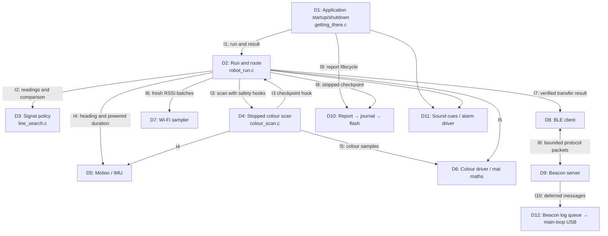

# Early-probe branch: architecture and code review

Base: `feature/early-probe-straight-on-first`, commit `159191b`.
Review branch: `codex/early-probe-quality-review`.

The intent remains: after an early side probe, continue straight unless a side
is clearly stronger than the retained best point. Timing, travel budgets, RSSI
thresholds, mat calibration, motor duty and the AP1-to-AP2 route are retained.
Bug fixes change exceptional paths, not the normal direction-choice policy.

## Course guidance applied

These references are PDF page positions in the local INF2004 lecture pack.
They are course guidance, not a claim that the slides prescribe these filenames,
this folder layout, an RTOS, or a particular coding standard such as MISRA.

| Source | Guidance | Application here |
|---|---|---|
| W1 Introduction to Embedded System, pp. 29, 32, 34, 36 | Exact widths; `volatile` is not atomicity; prefer private module state; small functions, clear interfaces, bounded loops and consistent style | Keep run state private, expose a small run API, retain fixed-size storage, synchronize BLE state/time snapshots, document callback ownership |
| W2.2 Interrupts, pp. 22, 25 | Short handlers; no blocking logging in an ISR; protect shared read-modify-write operations | Preserve deferred radio logs and short critical sections; test an IRQ at the BLE timeout boundary |
| W4.1 Embedded Operating System, p. 3 | Predictable worst-case response and bounded blocking matter | Retain STOP, per-leg deadline and powered-travel budgets; distinguish host timing models from measured hardware latency |
| W4.2 State Machine, pp. 3, 5, 13, 17 | Explicit states/events/guards/actions; exercise state/event combinations | Validate beacon protocol transitions before changing buffers; preserve the existing BLE state machine and navigation outcomes |
| W5 Requirements & Design, pp. 17-18, 29, 36 | Modules and labelled interfaces; separate high-level design from implementation; cover normal/error interactions | Module diagram and interface contracts below; split startup, run orchestration, scan service and signal maths |
| W6 Traceability & Testing, pp. 8, 23, 27-28, 38, 40 | Requirement → design → function → test; boundaries, exceptional inputs, timing and interface faults | Trace table, new failure regressions, optimized host checks, sanitizer support and CI |
| W6 Traceability & Testing, pp. 47-50 | Whole-system behaviour needs real hardware and environment tests | Explicit hardware qualification list below; host tests are not an end-to-end hardware result |

## Modules and ownership



- **I1:** main-core calls only; radio and drivers ready, STOP armed and report
  open. A successful run means every requested payload has been verified.
  Startup, replay and radio shutdown remain in the application.
- **I2:** RSSI is represented as a positive magnitude code (127 means missing),
  decoded to negative dBm for sums. A positive comparison means the second
  argument is stronger. Ties and missing values do not create a direction.
- **I3:** a scan starts stopped, turns at 30-degree intervals and takes three
  readings at each stop. The caller supplies deadline/STOP and safe-checkpoint
  callbacks. Failure returns an invalid estimate; no translation is performed.
- **I4:** heading is degrees; duration and powered elapsed time are milliseconds.
  Navigation accounts actual powered time. Motion owns PWM, gyro integration and
  the latched STOP; no report writes while motors are powered.
- **I5:** sensor values are raw 16-bit channels; ratios are scaled by 1000.
  Classification uses the existing measured thresholds. Arrival history is reset
  per leg. A cancelled direction vector does not identify a bearing.
- **I6:** scan callbacks update bounded sample state. Before BLE or flash,
  navigation stops motors and drains Wi-Fi callbacks. Moving sampling remains off
  by default and requires explicit timing qualification.
- **I7/I8:** BLE callbacks own protocol transitions; the main loop observes
  state/time together under an interrupt mask. Packets must match the active
  connection, phase, exact size, sequence, advertised length and storage bounds.
  Completion requires CRC validation and the final acknowledgement.
- **I9:** storage calls are permitted only while stopped and radio work is
  quiescent (or after radio shutdown). A storage failure prevents further motion.
  Journal records retain their existing CRC and recovery rules.
- **I10:** beacon radio callbacks enqueue bounded messages on core 0. Only the
  main loop writes USB. The fixed queue drops new messages when full and reports
  dropped/truncated counts; flush work has a per-call limit. Core 1 does not use
  this queue. Losing diagnostic text never advances the transfer protocol.

`robot_run.c` is still the largest module because the route, retained best point,
dip recovery and mat handover share one lifetime and travel budget. Its state
remains file-private. Further splitting should introduce a deliberate run context
and interface tests, not expose those globals through `extern` declarations.

## Reproducible defects addressed

| Defect and trigger | Correction | Regression evidence |
|---|---|---|
| A correction log delays a stopped turn, then that gap is integrated at the next powered gyro rate | Refresh integration time immediately before restarting the turn motors | `tests/test_motion.c`: delayed correction logs, both directions and gyro signs |
| Equal, opposite colour-depth vectors cancel, but floating-point residue becomes a valid arbitrary heading | Reject cancellation within a scale-dependent roundoff tolerance | `tests/test_colour.c`: rotated symmetric cases and a genuinely asymmetric direction |
| A mat first detected during a stationary dip recheck or forward probe is ignored, allowing another probe/reversal | Hand over to mat steering before another translation | `tests/test_navigation.c`: recheck and both probe positions |
| A BLE callback changes phase/start time between main-loop timeout reads | Snapshot the clock, state and start time together; commit abort under the same short critical section | `tests/test_payload_client.c`: injected callback at the timeout-read boundary |
| Rejected file metadata and out-of-order beacon commands remain able to advance transfer state/buffers | Validate phase and bounds before mutation; reset rejected transfer metadata; protect the pending reply | `tests/test_beacon_server.c`: rejected metadata, invalid sequencing and complete valid exchanges |
| Buzzer alarm returns a positive period while claiming timing relative to the previous deadline | Return the negative period required by the Pico alarm API | `tests/test_buzzer.c`: delayed callbacks, repeated/tail patterns and cancellation |
| Beacon background radio callbacks print directly to USB | Queue bounded messages; main flushes them with explicit loss accounting | `tests/test_beacon_log.c`: IRQ/output separation, overflow, truncation and partial writes |
| Short CMake target names produce different UF2 names from the README | Set output names before registering SDK outputs; retain short object-path target names | Full root build and firmware manifest |

## Traceability and regression checks

The identifiers below label existing behavioural contracts and review regressions;
they do not replace the team's approved project requirements.

| ID | Contract | Design / code | Host evidence | Hardware follow-up |
|---|---|---|---|---|
| R-START | No movement/radio/log erase before explicit start; preserve replay | D1, `wait_start_release`, report lifecycle | Navigation startup/STOP/replay scenarios | Buttons and boot replay on board |
| R-STOP | STOP/fault prevents further commanded motion | D2/D5, `run_can_continue`, motion driver | Navigation and motion fault injection | Measure worst-case STOP-to-PWM-off latency |
| R-LIMIT | Each leg has bounded run and powered-travel budgets | D2, `begin_leg`, `reserve_translation` | Deadline rollover, partial motion, return reservations | Scope powered times under radio/I2C load |
| R-DIRECTION | Early probe continues straight unless a side beats the retained best | D2/D3, `approach_loop`, `line_side_compare` | Existing recorded/synthetic early-probe scenarios | Repeat AP2 straight/side placements |
| R-MAT | Newly detected mat hands over while scan budget remains; avoided-mat recovery retains priority; ambiguous scan cannot invent a vector | D2/D4/D6 | Dip-handover, symmetric vectors and scanner failure tests | Mat entry, shadows and inner-ring approach |
| R-TRANSFER | Only a correctly sequenced, bounded, CRC-verified exchange can complete | D8/D9 | Client and server protocol tests, malformed packet cases | Both payloads and final ACK over actual BLE |
| R-PERSIST | Interrupted writes do not silently produce a valid corrupted report | D10 | CRC, power-cut recovery, all flash sectors/boundaries | Power-cycle and replay on Pico W |
| R-CUE | Repeating sound timing uses the intended previous deadline | D11 | Delayed alarm and stop tests | Verify buzzer/STOP under flash and radio load |
| R-LOG | Beacon callback logging never writes USB or grows memory without a bound | D12 | Queue/USB isolation and loss-accounting tests | Disconnect/reconnect serial during transfers |

The navigation suite intentionally includes the run implementation for white-box
checks of bounded return paths and state. The firmware build separately compiles
all modules, catching linkage/API mistakes that such an inclusion could hide.
The scanner tests call its public interface with fake motion and storage hooks.
The colour-scan diagnostic is also built and run as its own host executable;
its stubs reject all radio access and translation. This checks the no-radio
firmware's full startup, scan, return-to-origin and failure paths.

## Repeating the checks

Pico SDK 2.3.0 must include its BTstack submodule. Use a native C compiler for
host tests, and the ARM compiler for firmware.

```sh
python3 getting_there/tests/run_host_checks.py --sdk "$PICO_SDK_PATH"
python3 getting_there/tests/run_host_checks.py --sdk "$PICO_SDK_PATH" --sanitize
node docs/tools/test_logparser.js
cmake -G Ninja -S . -B build-review -DCMAKE_BUILD_TYPE=Release
cmake --build build-review --parallel
```

The host runner uses C11, `-O2`, warnings as errors, and bounded test-process
timeouts. `--sanitize` adds AddressSanitizer and UndefinedBehaviorSanitizer;
`--sanitize undefined` is available when ASan cannot initialize on the host.
The review machine's Apple ASan runtime deadlocked in its initializer before
`main`; that is not a passing ASan result. Local UBSan and CI results are reported
separately. The CI workflow runs both sanitizers on Linux and builds all targets.

## Hardware qualification still required

1. Build/flash the route robot and both corresponding beacon firmwares from this
   branch. Keep the reviewed source commit and UF2 hashes with the run log.
2. Repeat straight-ahead and side AP2 placements, including mat entry during
   weak-signal recovery. Confirm no extra probe/reverse after the handover.
3. Check turn correction accuracy under slow/disconnected USB logging, and
   ambiguous colour scans under the actual lighting.
4. Verify STOP during translation, turns, scan, transfer, sounds and log writes.
   Measure latency; a simulated 5 ms poll is not a measured hardware guarantee.
5. Confirm both payloads, CRCs and final ACKs, then power-cycle and replay the log.

Timed travel still assumes traction; RSSI is not a distance measurement. The
existing centre-arrival override and BLE-only fallback when the colour sensor
fails are retained design choices, not newly validated safety guarantees. The
memory/radio tests use controlled stubs and cannot prove CYW43 coexistence or
electrical behaviour. No robot was driven or flashed during this review.

## Local verification record (22 November 2026)

- All 16 optimized host executables pass, including the no-radio diagnostic,
  all three beacon servers, log queue, motion, radio client and flash journal.
- The same 16 executables pass with UndefinedBehaviorSanitizer and no recovery.
- All 27 saved runs parse and the dashboard field-map checks pass.
- All eleven Release firmware targets build with Pico SDK 2.3.0 and Arm GNU
  15.2.1. Project sources emit no warnings with `-Wall -Wextra`; initial picotool
  bootstrap emitted two host-tool warnings (a C++ standard warning and duplicate
  linker libraries), neither in firmware sources.
- Checked-in UF2s are rebuilt from this review. Exact source/toolchain identifiers
  and SHA-256 values are in [firmware-build.json](firmware-build.json).
- AddressSanitizer on this Mac did not start; the Linux workflow performs that
  check separately. No physical hardware qualification was performed.
